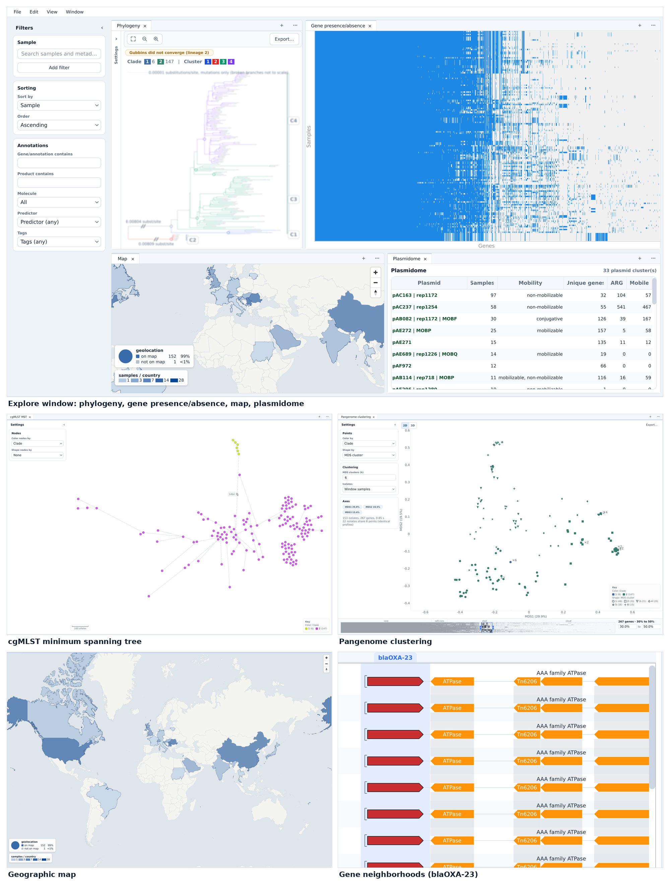

# BACTolomew

BACTolomew takes a set of bacterial genome assemblies through QC, annotation, typing, AMR,
plasmid, pangenome and phylogenetic analysis, then lets you explore the results in a desktop
app: linked tables, trees, pangenome and plasmid views, gene neighborhoods and maps.

Every analysis tool runs from one container image, so the host needs only a small Python
app and a container runtime. The same `bactolomew` command opens the window on a
laptop or runs headless on an HPC node. Finished runs can be packed into one file and opened
by colleagues who only install the viewer.



A run of 153 *Acinetobacter baumannii* genomes: the explore window (phylogeny, gene
presence/absence, map, plasmidome), the cgMLST minimum spanning tree, pangenome clustering,
the geographic map and the *bla*<sub>OXA-23</sub> gene neighborhoods.

## Contents

- [What it does](#what-it-does)
- [Installation](#installation)
  - [Ubuntu and Debian](#ubuntu-and-debian)
  - [Fedora](#fedora)
  - [Rocky, Alma and RHEL 9](#rocky-alma-and-rhel-9)
  - [openSUSE Leap and Tumbleweed](#opensuse-leap-and-tumbleweed)
  - [Arch](#arch)
  - [macOS](#macos)
  - [Windows 10 and 11](#windows-10-and-11)
  - [HPC and servers](#hpc-and-servers)
  - [Starting it again later](#starting-it-again-later)
- [Getting started](#getting-started)
  - [Tutorial with an example dataset](docs/TUTORIAL.md)
  - [Set up the full pipeline](#set-up-the-full-pipeline)
  - [Set up a viewer](#set-up-a-viewer)
  - [Share a run](#share-a-run)
  - [Turn a viewer into a full install](#turn-a-viewer-into-a-full-install)
- [The run list](#the-run-list)
- [Command line and HPC](#command-line-and-hpc)
- [Gene categories](#gene-categories)
- [Your own databases](#your-own-databases)
- [cgMLST schemes](#cgmlst-schemes)
- [Outputs](#outputs)
- [Tools and versions](#tools-and-versions)
- [Development](#development)
- [Citation](#citation)
- [License](#license)

## What it does

The pipeline runs assembly QC, Bakta annotation, MLST, AMRFinderPlus (acquired genes and point
mutations), MOB-suite plasmids, a Panaroo pangenome, a recombination-aware core-genome
phylogeny (core alignment, FastBAPS lineages, Gubbins per lineage, IQ-TREE), a Snippy SNP
tree, chewBBACA cgMLST, and searches of databases you add yourself. An interrupted run can be
resumed from where it stopped (Resume in the run list, or `run --resume`), and a step is rerun
only when its inputs change.

The explorer is a set of dockable panels: an annotation table, a genome track, gene
neighborhoods and sequence alignment for looking at genes; a core-genome phylogeny, cgMLST
minimum spanning trees and pangenome clustering for population structure; a presence/absence
heatmap and a plasmidome view for gene content; and a map and summary charts for metadata. Every
panel follows the same filters and sample selection. You can spread the panels over several
windows and arrange them however you like; Window > Layouts has a few built-in layouts to start
from, and you can save your own there.

Metadata comes from a CSV with a `Sample` column, or from the run itself (species, MLST,
lineages from FastBAPS or fastGEAR, and assembly QC).

## Installation

BACTolomew can be installed in two ways, and a viewer can be turned into a full install later:

- **Full pipeline** (run analyses and view them): a container runtime (Docker, Podman or
  Apptainer/Singularity), 16 GB RAM (32 GB recommended) and the disk space described below.
- **Viewer only** (open runs others shared): about 1 GB of disk, no container runtime.

Installing takes two steps. `bash install.sh` installs the app (about 1 GB). The first time
you start it, unless you choose Viewer only, setup downloads about 50 GB: the tools image (about
7 GB compressed, about 20 GB once unpacked), the Bakta database (39.4 GB, unpacked to 76 GB)
and the CheckM2 database (1.7 GB). Before it starts, setup checks that the disk for the
databases has about 125 GB free: about 121 GB for the Bakta database, which needs room for the
archive while it unpacks, and the rest for CheckM2. The tools image takes its 20 GB in the
container runtime's storage on top of that. Afterwards about 100 GB stay
in use (Bakta 76 GB, the tools image 20 GB, CheckM2 3 GB), plus your runs.

`bash install.sh --viewer` (`-Viewer` on Windows) skips the Full or Viewer only choice at first
start and installs a viewer straight away. The installer checks what is missing and prints the exact
command to fix it.

On Linux (x86_64) the desktop window needs glibc 2.34 or newer (check with `ldd --version`).
Older systems, down to glibc 2.28, can still run analyses from the command line: install with
`bash install.sh --headless`, which leaves out the window (so it can't be combined with
`--viewer`). On 64-bit ARM Linux the window is not supported, and the command line has not
been tested there. macOS needs version 13 or newer for the window (12 for the command line
only).

Pick the section for your system and follow it from top to bottom; each one is complete on its
own. Run the commands of each step in the order shown, one line at a time (a whole block also
works once `sudo` has your password). To paste: Ctrl+Shift+V or right-click > Paste in a Linux
terminal, Cmd+V in macOS Terminal, right-click in PowerShell. When `sudo` asks for a password,
type your login password; nothing appears while you type it. The Linux steps were tested in
clean containers (Ubuntu, Debian, Fedora, Rocky, openSUSE, Arch); macOS and Windows have not
been tested on a real machine yet. [docs/INSTALL.md](docs/INSTALL.md) has more detail, common
problems and how to uninstall.

### Ubuntu and Debian

Ubuntu 22.04 or newer, Debian 12 or newer.

1. Open a terminal: press Ctrl+Alt+T, or search for "Terminal" in the applications menu.
2. Install git, Python and Docker, and let your user run Docker:

   ```bash
   sudo apt update                                          # refreshes the list of packages
   sudo apt install -y git python3 python3-venv docker.io   # installs git, Python and Docker
   sudo systemctl enable --now docker                       # starts Docker, now and at every boot
   sudo usermod -aG docker $USER                            # lets your user run Docker
   ```

   For a viewer only install, leave out `docker.io` and skip the last two commands. On Debian,
   if `sudo` says you are not in the sudoers file, see
   [Common problems](docs/INSTALL.md#common-problems).
3. Log out of your desktop and log back in (or restart the computer), so that your user can
   use Docker. This is needed only once. Then open a terminal again. Viewer only: skip this
   step.
4. Download BACTolomew into your home folder and install it:

   ```bash
   cd ~                                                     # goes to your home folder
   git clone https://github.com/liviurotiul/BACTolomew.git  # downloads BACTolomew into the folder BACTolomew
   cd BACTolomew                                            # goes into that folder
   bash install.sh                                          # installs the app (a few minutes); for a viewer: bash install.sh --viewer
   ```

   If it warns that the window needs system libraries or a font, it prints a command to paste
   for each (a few lines above the line that starts with "Done. Launch with:"). Run the `sudo apt install ...` line
   under "Install them with:", and the font command if there is one; that is enough. The longer
   "full set" line below them is only for minimal or server installs. When apt asks "Do you
   want to continue? [Y/n]", press Enter.

   Then check the install:

   ```bash
   ./bactolomew check                                       # lists what is ready and what is missing
   ```

   The "Qt (window)" line should say ok. For a full install, the Runtime line should name
   docker; Config, Tool image and the database lines say MISSING until the first start
   installs them. If Runtime says MISSING, run `groups`: if the list has no docker, log out
   and back in (step 3). A viewer only install should end with "Ready to view runs."
5. Start BACTolomew:

   ```bash
   ./bactolomew                                             # opens the BACTolomew window
   ```

   The first time, it asks whether this is a **Full** install or **Viewer only**, and a full
   install then downloads the tools and databases; [Getting started](#getting-started) walks
   you through it. To start it again later, see [Starting it again later](#starting-it-again-later).

### Fedora

A recent Fedora (tested on Fedora 42).

1. Open a terminal: press the Super (Windows) key, type "Terminal" and press Enter.
2. Install git, Python and Docker, and let your user run Docker:

   ```bash
   sudo dnf install -y git python3 moby-engine              # installs git, Python and Docker
   sudo systemctl enable --now docker                       # starts Docker, now and at every boot
   sudo usermod -aG docker $USER                            # lets your user run Docker
   ```

   For a viewer only install, leave out `moby-engine`, skip the last two commands and go
   straight to step 4. To use Podman instead of Docker, run only
   `sudo dnf install -y git python3 podman` (Fedora usually has Podman already; then dnf just
   says so) and go straight to step 4.
3. Log out of your desktop and log back in (or restart the computer), so that your user can
   use Docker. This is needed only once. Then open a terminal again. Viewer only or Podman:
   skip this step.
4. Download BACTolomew into your home folder and install it:

   ```bash
   cd ~                                                     # goes to your home folder
   git clone https://github.com/liviurotiul/BACTolomew.git  # downloads BACTolomew into the folder BACTolomew
   cd BACTolomew                                            # goes into that folder
   bash install.sh                                          # installs the app (a few minutes); for a viewer: bash install.sh --viewer
   ```

   If it warns that the window needs system libraries or a font, it prints a command to paste
   for each (a few lines above the line that starts with "Done. Launch with:"). Run the `sudo dnf install ...` line
   under "Install them with:", and the font command if there is one; that is enough. The longer
   "full set" line below them is only for minimal or server installs. When dnf asks "Is this ok
   [y/N]", type y and press Enter.

   Then check the install:

   ```bash
   ./bactolomew check                                       # lists what is ready and what is missing
   ```

   The "Qt (window)" line should say ok. For a full install, the Runtime line should name
   docker (or podman); Config, Tool image and the database lines say MISSING until the first
   start installs them. If Runtime says MISSING with Docker, run `groups`: if the list has no
   docker, log out and back in (step 3). A viewer only install should end with "Ready to view
   runs."
5. Start BACTolomew:

   ```bash
   ./bactolomew                                             # opens the BACTolomew window
   ```

   The first time, it asks whether this is a **Full** install or **Viewer only**, and a full
   install then downloads the tools and databases; [Getting started](#getting-started) walks
   you through it. To start it again later, see [Starting it again later](#starting-it-again-later).

### Rocky, Alma and RHEL 9

Version 9 or newer. On version 8 the window does not run: use the same steps with
`bash install.sh --headless` and the [command line](#command-line-and-hpc).

1. Open a terminal: click Activities, type "Terminal" and press Enter. On a server you reach
   with `ssh` (no screen), the window cannot open: follow [HPC and servers](#hpc-and-servers)
   instead.
2. Install git, Python 3.12 (the system's Python 3.9 is too old) and Podman:

   ```bash
   sudo dnf install -y git python3.12 podman                # installs git, Python 3.12 and Podman
   ```

   If `sudo` says you are not in the sudoers file, your user may not install software here:
   ask the computer's administrator to run this command for you, or to add you to the `wheel`
   group. For a viewer only install, leave out `podman`. Podman needs no extra setup and no
   logging out. To use Docker instead, see [docs/INSTALL.md](docs/INSTALL.md#rocky-alma-and-rhel).
3. Download BACTolomew into your home folder and install it:

   ```bash
   cd ~                                                     # goes to your home folder
   git clone https://github.com/liviurotiul/BACTolomew.git  # downloads BACTolomew into the folder BACTolomew
   cd BACTolomew                                            # goes into that folder
   bash install.sh                                          # installs the app (a few minutes); for a viewer: bash install.sh --viewer
   ```

   If it warns that the window needs system libraries or a font, it prints a command to paste
   for each (a few lines above the line that starts with "Done. Launch with:"). Run the `sudo dnf install ...` line
   under "Install them with:", and the font command if there is one; that is enough. The longer
   "full set" line below them is only for minimal or server installs. When dnf asks "Is this ok
   [y/N]", type y and press Enter.

   Then check the install:

   ```bash
   ./bactolomew check                                       # lists what is ready and what is missing
   ```

   The "Qt (window)" line should say ok. For a full install, the Runtime line should name
   podman (or docker); Config, Tool image and the database lines say MISSING until the first
   start installs them. A viewer only install should end with "Ready to view runs."
4. Start BACTolomew:

   ```bash
   ./bactolomew                                             # opens the BACTolomew window
   ```

   Over `ssh` without a screen it stops with "No display": set it up as in
   [HPC and servers](#hpc-and-servers) (`./bactolomew setup --yes`, then the command line).

   The first time, it asks whether this is a **Full** install or **Viewer only**, and a full
   install then downloads the tools and databases; [Getting started](#getting-started) walks
   you through it. To start it again later, see [Starting it again later](#starting-it-again-later).

### openSUSE Leap and Tumbleweed

Leap 15.6 or newer, or Tumbleweed.

1. Open a terminal: search for "Terminal" (or "Konsole") in the applications menu.
2. Install git, Python 3.12, Docker and a font, and let your user run Docker:

   ```bash
   sudo zypper install -y git python312 docker dejavu-fonts # installs git, Python 3.12, Docker and a font
   sudo systemctl enable --now docker                       # starts Docker, now and at every boot
   sudo usermod -aG docker $USER                            # lets your user run Docker
   ```

   For a viewer only install, leave out `docker` and skip the last two commands.
3. Log out of your desktop and log back in (or restart the computer), so that your user can
   use Docker. This is needed only once. Then open a terminal again. Viewer only: skip this
   step.
4. Download BACTolomew into your home folder and install it:

   ```bash
   cd ~                                                     # goes to your home folder
   git clone https://github.com/liviurotiul/BACTolomew.git  # downloads BACTolomew into the folder BACTolomew
   cd BACTolomew                                            # goes into that folder
   bash install.sh                                          # installs the app (a few minutes); for a viewer: bash install.sh --viewer
   ```

   If it warns that the window needs system libraries or a font, it prints a command to paste
   for each (a few lines above the line that starts with "Done. Launch with:"). Run the `sudo zypper install ...` line
   under "Install them with:", and the font command if there is one; that is enough. The longer
   "full set" line below them is only for minimal or server installs. When zypper asks
   "Continue? [y/n/v/...? shows all options] (y)", press Enter.

   Then check the install:

   ```bash
   ./bactolomew check                                       # lists what is ready and what is missing
   ```

   The "Qt (window)" line should say ok. For a full install, the Runtime line should name
   docker; Config, Tool image and the database lines say MISSING until the first start
   installs them. If Runtime says MISSING, run `groups`: if the list has no docker, log out
   and back in (step 3). A viewer only install should end with "Ready to view runs."
5. Start BACTolomew:

   ```bash
   ./bactolomew                                             # opens the BACTolomew window
   ```

   The first time, it asks whether this is a **Full** install or **Viewer only**, and a full
   install then downloads the tools and databases; [Getting started](#getting-started) walks
   you through it. To start it again later, see [Starting it again later](#starting-it-again-later).

### Arch

1. Open a terminal from your desktop's applications menu.
2. Update the system, install git, Python, Docker and a font, and let your user run Docker:

   ```bash
   sudo pacman -Syu --needed --noconfirm git python docker ttf-dejavu  # updates the system and installs git, Python, Docker and a font
   sudo systemctl enable --now docker                       # starts Docker, now and at every boot
   sudo usermod -aG docker $USER                            # lets your user run Docker
   ```

   For a viewer only install, leave out `docker` and skip the last two commands.
3. Log out of your desktop and log back in (or restart the computer, which is best if the first
   command updated the kernel), so that your user can use Docker. This is needed only once.
   Then open a terminal again. Viewer only: skip this step.
4. Download BACTolomew into your home folder and install it:

   ```bash
   cd ~                                                     # goes to your home folder
   git clone https://github.com/liviurotiul/BACTolomew.git  # downloads BACTolomew into the folder BACTolomew
   cd BACTolomew                                            # goes into that folder
   bash install.sh                                          # installs the app (a few minutes); for a viewer: bash install.sh --viewer
   ```

   If it warns that the window needs system libraries or a font, it prints a command to paste
   for each (a few lines above the line that starts with "Done. Launch with:"). Run the `sudo pacman -S --needed ...` line
   under "Install them with:", and the font command if there is one; that is enough. The longer
   "full set" line below them is only for minimal or server installs. When pacman asks
   "Proceed with installation? [Y/n]", press Enter.

   Then check the install:

   ```bash
   ./bactolomew check                                       # lists what is ready and what is missing
   ```

   The "Qt (window)" line should say ok. For a full install, the Runtime line should name
   docker; Config, Tool image and the database lines say MISSING until the first start
   installs them. If Runtime says MISSING, run `groups`: if the list has no docker, log out
   and back in (step 3). A viewer only install should end with "Ready to view runs."
5. Start BACTolomew:

   ```bash
   ./bactolomew                                             # opens the BACTolomew window
   ```

   The first time, it asks whether this is a **Full** install or **Viewer only**, and a full
   install then downloads the tools and databases; [Getting started](#getting-started) walks
   you through it. To start it again later, see [Starting it again later](#starting-it-again-later).

### macOS

macOS 13 or newer, on an Intel or an Apple Silicon (M1 to M4) Mac. To see which one you have:
Apple menu > About This Mac ("Chip: Apple M..." is Apple Silicon, "Processor: ... Intel" is Intel).

1. Open Terminal: press Cmd+Space, type "Terminal" and press Enter.
2. Install Apple's command line tools, which include git. A window opens: click Install and wait
   until it finishes; if it says they are already installed, go on.

   ```bash
   xcode-select --install
   ```

3. Install [Homebrew](https://brew.sh), which installs Python for you. It asks for your Mac
   password, then asks you to press Enter to continue.

   ```bash
   /bin/bash -c "$(curl -fsSL https://raw.githubusercontent.com/Homebrew/install/HEAD/install.sh)"
   ```

   On Apple Silicon, Homebrew ends with "Next steps" asking you to add it to your PATH. Run
   these two commands (Intel Macs don't need them). The first makes the `brew` command work in
   every new Terminal window, the second in this one:

   ```bash
   echo 'eval "$(/opt/homebrew/bin/brew shellenv)"' >> ~/.zprofile
   eval "$(/opt/homebrew/bin/brew shellenv)"
   ```

4. Install Python 3.12:

   ```bash
   brew install python@3.12
   ```

5. Install Docker Desktop (skip this step for a viewer only install): download it from
   [docker.com](https://docs.docker.com/desktop/setup/install/mac-install/), picking "Apple
   silicon" or "Intel chip" to match your Mac, open the downloaded file and drag Docker to
   Applications. Start Docker from Applications and accept its terms. Then in Docker's
   Settings (the gear) > Resources, set the memory limit to at least 16 GB (32 GB if you can)
   and the disk usage limit to at least 150 GB, and click Apply & restart. Docker Desktop is free
   for personal use, education and small companies.
6. Make a case-sensitive volume for BACTolomew. Some tool outputs have file names that differ
   only in upper and lower case, which the normal Mac disk can't keep apart. Open Disk Utility
   (Cmd+Space, type "Disk Utility"), select your main disk ("Macintosh HD") in the sidebar,
   click the + button (Add Volume), name it `Genomics`, choose the format "APFS
   (Case-sensitive)" and click Add. It shares free space with the rest of the disk.
7. Download BACTolomew onto that volume and install it. The commands go to the new volume,
   download BACTolomew into a folder named BACTolomew, go into that folder and install the app
   (a few minutes). For a viewer only install, run the last one as `bash install.sh --viewer`.

   ```bash
   cd /Volumes/Genomics
   git clone https://github.com/liviurotiul/BACTolomew.git
   cd BACTolomew
   bash install.sh
   ```

8. Start BACTolomew (this opens its window):

   ```bash
   ./bactolomew
   ```

   The first time, it asks whether this is a **Full** install or **Viewer only**, and a full
   install then downloads the tools and databases; [Getting started](#getting-started) walks
   you through it. To start it again later, see [Starting it again later](#starting-it-again-later).

On Apple Silicon the published tools image is for Intel only, so a full install's first setup
builds a native one on your Mac (about an hour; Docker Desktop needs at least 16 GB of memory
for the build). fastGEAR, an optional alternative for lineage detection, does not run there, but
FastBAPS (the default) does. Running the Intel image under Rosetta is also possible but
untested; see [docs/INSTALL.md](docs/INSTALL.md#macos-apple-silicon-m1-to-m4).

### Windows 10 and 11

BACTolomew runs inside WSL2 (the Linux system built into Windows), and its window opens on the
Windows desktop. You need Windows 10 version 21H2 or newer, or Windows 11.

1. Open PowerShell: click Start, type "PowerShell" and click **Windows PowerShell**. Don't
   choose "Run as administrator"; the script asks for that itself when it needs it.
2. Download the installer and run it:

   ```powershell
   Invoke-WebRequest -UseBasicParsing -Uri https://raw.githubusercontent.com/liviurotiul/BACTolomew/main/install_windows.ps1 -OutFile install_windows.ps1   # downloads the installer
   powershell -ExecutionPolicy Bypass -File .\install_windows.ps1                                                                                         # runs it
   ```

   For a viewer only install, run the second command with `-Viewer` at the end.
3. Answer what the script asks. It sets up WSL2 and Ubuntu, then Docker, installs BACTolomew
   inside Ubuntu and adds it to the Start Menu. Along the way:
   - When Windows asks whether to allow changes, click **Yes** (needed once, to turn on WSL).
   - If it says Windows must restart, restart, open PowerShell again as in step 1 and run the
     second command of step 2 again (the same way, with `-Viewer` if you used it). It
     continues where it stopped. This can happen once or twice.
   - When Ubuntu is installed, it asks for a new Linux user name and password: a short user
     name in lowercase letters, with no spaces, and a password (nothing appears on screen while
     you type it; you type it twice). Remember the password. When you then see a Linux prompt (ending in `$`), type `exit` and
     press Enter to go back to the installer.
   - It asks how to get Docker (not for a viewer): **1** (Docker Desktop) is the simplest. If
     it installs Docker Desktop, follow the steps it prints (start Docker Desktop, turn on the
     WSL integration for Ubuntu-24.04) and then run the second command of step 2 again.
4. Start BACTolomew: click Start and type "BACTolomew". The first time, it asks whether this is a
   **Full** install or **Viewer only**, and a full install then downloads the tools and
   databases; [Getting started](#getting-started) walks you through it. You start it the same
   way every time.

### HPC and servers

On a cluster or a server without a screen, install the command line only:

1. Log in to the server with `ssh` as usual, and go to a folder with about 150 GB free (often a
   project or scratch folder rather than your home folder):

   ```bash
   cd /path/with/space                                      # goes to a folder with room for the databases
   ```

2. Make Apptainer available (most clusters have it instead of Docker; the module name can
   differ, `module avail` lists them):

   ```bash
   module load apptainer                                    # loads Apptainer on clusters that use modules
   apptainer --version                                      # checks that it works
   ```

3. Download BACTolomew and install it:

   ```bash
   git clone https://github.com/liviurotiul/BACTolomew.git  # downloads BACTolomew into the folder BACTolomew
   cd BACTolomew                                            # goes into that folder
   bash install.sh --headless                               # installs the command line version, no window
   ```

   If `install.sh` finds no suitable Python, load one first (for example
   `module load python/3.12`; names differ between clusters) and run it again.
4. Download the tools image and the databases. This takes several hours, and a dropped `ssh`
   connection or a laptop going to sleep would stop it, so run it inside `tmux` (or `screen`),
   or as a batch job if your cluster stops long jobs on login nodes:

   ```bash
   tmux new -s bact                                         # opens a session that keeps running if you disconnect
   ./bactolomew setup --yes --runtime apptainer             # downloads the tools image and the databases; or docker, podman
   ```

   If the connection drops, log in again and run `tmux attach -t bact` to get back to it. If
   setup was interrupted anyway, run the same setup command again: it keeps what it already
   downloaded.
5. Run an analysis:

   ```bash
   ./bactolomew run --genomes /path/to/assemblies --out /path/to/run   # analyzes one FASTA file per genome
   ```

With Apptainer, setup converts the tools image to a `.sif` file (about 15 GB more). The
Apptainer route has not been tested on a real cluster yet, so try a small run first. See
[Command line and HPC](#command-line-and-hpc) below for Slurm jobs and the other commands.

### Starting it again later

- **Linux:** open a terminal and run `cd ~/BACTolomew && ./bactolomew`.
- **macOS:** for a full install, first start Docker Desktop from Applications and wait until it
  says Docker is running (or turn on Settings > General > Start Docker Desktop when you sign
  in). Then open Terminal and run `cd /Volumes/Genomics/BACTolomew && ./bactolomew`.
- **Windows:** if you use Docker Desktop, first start it from the Start Menu and wait until it
  says Docker is running (or turn on Settings > General > Start Docker Desktop when you sign
  in). Then click Start and type "BACTolomew".
- **Servers:** log in, run `module load apptainer` again (and `module load python/...` if you
  needed it), then `cd` into the BACTolomew folder and run `./bactolomew run ...` (or
  `./bactolomew check`).

A viewer only install does not need Docker, so it can skip the Docker Desktop part.

## Getting started

New here? Try the [tutorial with an example dataset](docs/TUTORIAL.md): download a finished
run, import it and explore it, in about 15 minutes.

### Set up the full pipeline

1. Install as above (`bash install.sh`).
2. Run `./bactolomew` and choose **Full (run analyses)**. On a server without a screen, run
   `./bactolomew setup --yes` instead.
3. Setup first checks that there is enough free disk space (see
   [Installation](#installation) for the sizes), then downloads each of these and shows its
   progress:
   - the tools image, `liviurotiul/bactolomew` from Docker Hub (built locally on Apple Silicon);
   - the full Bakta database (the largest, about 1 to 2 hours), which includes the
     AMRFinderPlus database;
   - the CheckM2 database.

   It finishes with a quick check that everything works. If something fails, click Retry and
   setup carries on from there.
4. When setup finishes, the [run list](#the-run-list) opens. (From a terminal,
   `./bactolomew check` now prints "Ready to run.")
5. Click **Start New Run**, then **Add Assemblies…** and pick one FASTA file per genome
   (`.fasta`, `.fa` or `.fna`, gzipped or not). Each file name, minus the suffix, becomes the
   sample name. Names may only contain letters, digits and `_ . - |`, and two names can't
   differ only in case.
6. Click OK to start. The run is saved under `runs/` in the BACTolomew folder. You don't need
   to give the species: MLST works it out, and if cgMLST.org has a scheme for it, the scheme is
   downloaded during the run (the first time, you'll be asked to accept the cgMLST.org terms;
   see [cgMLST schemes](#cgmlst-schemes) for species without one). **Monitor** shows each step
   as it runs.
7. When the run is done, click **View**. BACTolomew asks for metadata: pick a CSV whose
   `Sample` column matches the sample names, or choose **Use run data only**. The other
   columns become filters and colors; a `Country` column (or `Latitude` and `Longitude`)
   places samples on the map. **Change Metadata...** in the run's **More** menu swaps the CSV
   later.

### Set up a viewer

1. Install with `bash install.sh --viewer` (on Windows:
   `powershell -ExecutionPolicy Bypass -File .\install_windows.ps1 -Viewer`).

   If you already ran plain `bash install.sh`, skip the reinstall: at first start choose
   **Viewer only (open results from others)**, or run `./bactolomew setup --viewer` on a
   machine without a screen.
2. Run `./bactolomew` (on Windows, BACTolomew in the Start Menu). It opens on the run list.
   (To confirm from a terminal, `./bactolomew check` prints "Ready to view runs.")
3. Click **Import Run...** and pick the `.zip` you were sent (or a run folder). A run made with
   a newer version shows a warning but can still be opened (**Open Anyway**).
4. Click **View** and pick a metadata CSV whose `Sample` column matches the sample names, or
   choose **Use run data only** (see step 7 of the full pipeline setup).

In a viewer, the few features that need the tools are grayed out, with a note saying why:
aligning sequences from a gene card (unless MAFFT is installed on the computer), adding
cgMLST schemes or databases, and starting or resuming runs.

### Share a run

On the machine that made the run, open its **More** menu in the run list and choose **Export
for Sharing...**. This writes one `.zip` with what the viewer needs and no paths from your
computer: about 0.5 GB for 150 genomes, plus about 4 MB per genome for the assemblies. The
assemblies and the metadata CSV are included by default; untick the assemblies to make the
file smaller. The other person can import the `.zip` as described above.

### Turn a viewer into a full install

Click **Set Up Pipeline…** in Settings (the gear button in the run list), or run
`./bactolomew setup`. It installs everything listed for the full pipeline.
`./bactolomew check` always tells you which mode you are in.

## The run list

The run list is the first window. Each run there has View, Monitor and Resume buttons and a
**More** menu. From here you start, monitor, resume and stop runs, open
finished ones, and import runs that others have shared with you. Each run's **More** menu has
the less common actions: run details, changing its metadata, exporting it and showing it in the
file manager.

The gear button opens Settings: compute limits, the lineage method (FastBAPS by default, or
fastGEAR, which is not available on Apple Silicon; `phylo.population_method` in the config),
cgMLST schemes and your own databases.

## Command line and HPC

`./bactolomew` (or `./bactolomew gui`) opens the window. Everything else works without a
display:

```bash
./bactolomew check                                   # checks the install, shows the cores and RAM a run would use
./bactolomew setup --yes [--runtime docker|podman|singularity|apptainer] [--sif PATH] [--viewer] [--dry-run]
./bactolomew run --genomes DIR --out DIR [--threads N] [--resume]
./bactolomew db --list
./bactolomew db --add proteins.faa --name MyDB --category AMR
./bactolomew db --remove MyDB
./bactolomew --version
```

- `setup` does the same first-time setup as the window and prints its progress as text.
  `--yes` answers yes to every prompt. Without `--runtime`, it uses the runtime already in the
  config, or else the first of Docker, Podman and Apptainer/Singularity that it finds. `--sif PATH` sets where the
  Apptainer/Singularity image lives (and implies `--runtime singularity`): if there is already
  an image at that path, setup uses it, and if not, setup pulls the tools image from Docker Hub
  and saves it there as a `.sif`.
- `run` takes a `--genomes` folder of FASTA files, one per genome, named as in
  [step 5](#set-up-the-full-pipeline) above. It takes the database paths from
  `bactolomew_config.json` (`run --help` lists the overrides) and refuses an output folder that
  already holds a run unless you pass `--resume`.
- Before the first run that needs a new cgMLST scheme, accept the cgMLST.org terms once by running, from the
  BACTolomew folder, `PYTHONPATH=src .venv/bin/python -m pipeline.CgmlstInstall --accept-terms`.
  Otherwise the run stops at the chewBBACA step; accept the terms, then continue with `run --resume`.
- The number of cores and the RAM a run uses follow the CPU affinity, cgroup limits and the
  Slurm allocation (`SLURM_CPUS_PER_TASK`, `SLURM_MEM_PER_NODE` or `SLURM_MEM_PER_CPU`), capped
  by `resources.max_threads` and `resources.max_ram_gb` in the config. The budget is logged at
  the start of each run.
- On a cluster without Docker, use Apptainer/Singularity (`setup --runtime apptainer`; see
  [HPC and servers](#hpc-and-servers)).

Setup writes `bactolomew_config.json` in the BACTolomew folder: database paths, container
runtime and image, and resource limits. Settings in the window edits the same file.

On Slurm, for example (submitted from the BACTolomew folder):

```bash
sbatch --cpus-per-task=32 --mem=64G --wrap "./bactolomew run --genomes /path/to/assemblies --out /path/to/run"
```

To look at a headless run, copy its run folder to any computer with BACTolomew (a viewer is
enough) and open it with **Import Run...**.

## Gene categories

Genes are put into categories (AMR, virulence, mobile elements, plasmid) using the tools the
pipeline already runs.

- **AMR**, point mutations, stress/metal/biocide resistance (BMRG) and the virulence genes
  that AMRFinderPlus reports with its `--plus` option come from AMRFinderPlus, with the AMRFinderPlus database that ships inside
  the Bakta database.
- **Virulence** and **mobile elements** come from Bakta's VFDB (virulence factor) and
  insertion sequence (IS) hits, plus Bakta product names for mobile elements and phages
  (marked as product name matches).
- MOB-suite's replicon, relaxase and mating pair formation (MPF) hits mark genes as
  **Plasmid**.

## Your own databases

BACTolomew comes with no marker databases of its own; the categories above come from the tools
the pipeline runs. To add one, in Settings > Databases click "Add database…", or run `./bactolomew db --add`. Give a protein
FASTA (plain or `.gz`) and a category: AMR, BMRG, VIRULENCE, MOBILE, PHAGE, PLASMID, or
COMPOUND for a locus of several genes (an operon or a resistance island, for example) that is
matched as one element. From the next run on, it is searched with DIAMOND and its hits appear
in the tables as "<name> (U)", where U marks a database you added. Check the license of any
database you add; the Add database dialog has a note field for it.

## cgMLST schemes

In Settings, "Download from cgMLST.org…" fetches a scheme directly, and "Add schema…" imports
one or more schemes you downloaded yourself. There is no `bactolomew` subcommand for schemes
yet; from the BACTolomew folder run:

```bash
PYTHONPATH=src .venv/bin/python -m pipeline.CgmlstInstall --list    # also --status, --install <species>, --install-all, --import <paths>
```

- cgMLST.org schemes are for non-commercial use only and may not be redistributed. The terms
  are shown once, before the first download.
- If your species has a cgMLST.org scheme that is not installed yet, the run installs it at
  its chewBBACA step. The window asks you to accept the terms before such a run starts; a
  command-line run stops at that step until you accept them (see
  [Command line and HPC](#command-line-and-hpc)).
- If your species has no scheme at all, the run stops at the chewBBACA step until you import
  one ("Add schema…" or `--import`); Resume then continues.
- chewBBACA adds the new alleles it finds to the installed scheme, so allele numbers stay
  comparable between runs. To start over from a fresh download, use
  `--install <species> --replace`; the old scheme is moved to `.replaced/` in the schemes
  folder.

## Outputs

A run folder (under `runs/` by default) has one subfolder per step (mostly named after its tool), and
the trees in `trees/`. The files most people look for:

- Annotations (GFF3, GenBank, protein FASTA): `bakta/<sample>/`
- AMR calls: `amrfinder/<sample>.tsv`
- Gene presence/absence: `panaroo/out/gene_presence_absence.csv`
- Trees (Newick): `trees/`, listed in `trees/trees.json`
- cgMLST allele profiles: `chewbbaca/out/results_alleles.tsv`

Three JSON files describe the run:

- `run_config.json`: the settings and the environment (image, tool versions, databases)
- `run_state.json`: step progress and warnings
- `run_report.json`: the provenance of the finished run

## Tools and versions

All tools come from the `liviurotiul/bactolomew` image on Docker Hub. The versions below are from
[`docker/locks/tool_versions.json`](docker/locks/tool_versions.json).

| Stage              | Tools |
| ------------------ | ----- |
| Assembly QC        | QUAST 5.3.0, CheckM2 1.1.0 |
| Annotation         | Bakta 1.10.4 |
| AMR                | AMRFinderPlus 4.0.23 (`--plus`, point mutations with `--organism` from the MLST species) |
| Typing             | mlst 2.35.0 (PubMLST data of 2025-12-29), chewBBACA 3.5.4 (cgMLST) |
| Plasmids           | MOB-suite 3.1.9 |
| Pangenome          | Panaroo 1.8.0 |
| Core phylogeny     | FastBAPS 1.0.8 (lineages, default), Gubbins 3.4.3, IQ-TREE 2.4.0; fastGEAR optional (x86_64 only) |
| SNP phylogeny      | Snippy 4.6.0, RAxML-NG 1.2.2 |
| Database searches  | DIAMOND 2.2.3 |
| Sequence alignment | MAFFT 7.526 (explorer) |

## Development

To run from a checkout without `install.sh`:

```bash
git clone https://github.com/liviurotiul/BACTolomew.git
cd BACTolomew
python3 -m venv .venv                        # Python 3.10 to 3.14
.venv/bin/pip install --require-hashes --only-binary :all: -r requirements.lock
cd src && ../.venv/bin/python -m annotation_explorer_polars.app
```

The tests use unittest and run offscreen:

```bash
QT_QPA_PLATFORM=offscreen PYTHONPATH=src .venv/bin/python -m unittest discover -s tests -p 'test_*.py'
```

The tool environments are defined in [`yamls/`](yamls/) and pinned exactly in
[`docker/locks/`](docker/locks/). Build the tools image with `bash docker/build.sh [version]`;
publishing it is described in [`docker/PUBLISHING.md`](docker/PUBLISHING.md).

## Citation

If you use BACTolomew, cite the release you used (`./bactolomew --version` prints it), for
example "BACTolomew v0.3.0, https://github.com/liviurotiul/BACTolomew/releases/tag/v0.3.0",
together with the tools listed in [Tools and versions](#tools-and-versions) and the databases
they use (Bakta, AMRFinderPlus, CheckM2, MOB-suite, PubMLST), which have their own licenses and
citations.

## License

BACTolomew is free software under the GNU General Public License version 3. See
[`LICENSE`](LICENSE).
