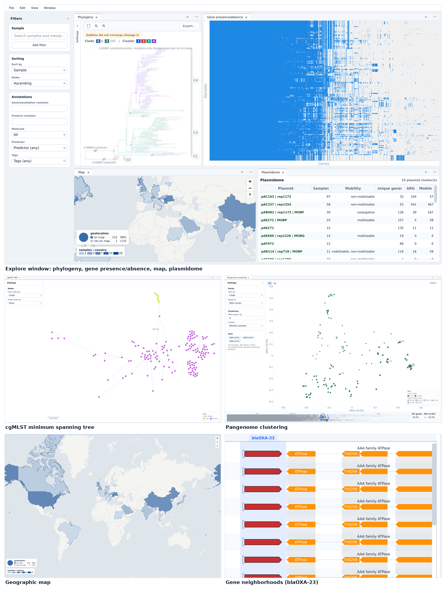

# BACTolomew

BACTolomew is a bacterial comparative-genomics platform: a desktop **annotation explorer**
(PyQt6 / WebEngine) backed by a reproducible, containerized **analysis pipeline**. It takes
bacterial assemblies from QC through annotation, typing, pangenome and phylogenetic analysis,
and lets you explore the results interactively: tables, trees, pangenome views, plasmid
views and geographic maps.



A run of 153 *Acinetobacter baumannii* genomes: the explore window (phylogeny, gene
presence/absence, map, plasmidome), the cgMLST minimum spanning tree, pangenome clustering,
the geographic map and the *bla*<sub>OXA-23</sub> gene neighborhoods.

## Features

- **Pipeline** (one command or one button): assembly QC, Bakta annotation, MLST,
  AMRFinderPlus (acquired genes and point mutations), MOB-suite plasmids, gene categories
  from the run's own evidence, Panaroo pangenome, a recombination-aware core-genome
  phylogeny (core alignment, FastBAPS lineages, Gubbins per lineage, IQ-TREE), a Snippy
  SNP tree, chewBBACA cgMLST and searches of the databases you add yourself. Every step is
  resumable and reused only when its inputs match.
- **Explorer**: dockable, multi-instance panels in one or several windows, all following one
  filter set and one sample set: Sample tree, Annotations, Genome track, Map, Phylogeny,
  Gene presence/absence, Metadata summary, Plasmidome, Pangenome clustering, cgMLST MST,
  cgMLST MST (compact), Gene neighborhoods and Sequence alignment. Built-in and saved
  layouts (Window > Layouts).
- **Metadata**: a CSV with a `Sample` column, or "Use run data only" (species, MLST,
  fastGEAR clades and assembly QC); More > Change Metadata... on the run's card in the
  run list swaps it later.
- **Shared runs**: More > Export for Sharing... packs what the explorer needs into one file;
  Import Run... in the run list opens it on another install, without the pipeline.
- **Runs on a laptop, a workstation or an HPC node**: the same `bactolomew` command opens
  the window or runs headless, with Docker, Podman (rootful or rootless) or
  Apptainer/Singularity.

## Architecture

BACTolomew is split into a **thin host layer** and a **fat container layer**:

- **Host (this repo)**: a lightweight Python venv running the PyQt6/WebEngine GUI and the
  in-process pipeline orchestration. No bioinformatics tools are installed on the host.
- **Container (`liviurotiul/bactolomew` on Docker Hub)**: a single image carrying every bioinformatics tool.
  Each tool call is dispatched as `conda run -n <env>` inside the container, with host
  directories bind-mounted at identical paths so absolute paths resolve unchanged. See
  [`docker/Dockerfile`](docker/Dockerfile).

This keeps the GUI fast and portable while making the analysis environment fully reproducible.

## Pipeline tools

The conda environments are defined in [`yamls/`](yamls/), pinned exactly in
[`docker/locks/`](docker/locks/) and baked into the tools image. Versions from
[`docker/locks/tool_versions.json`](docker/locks/tool_versions.json):

| Stage              | Tools |
| ------------------ | ----- |
| Assembly QC        | QUAST 5.3.0, CheckM2 1.1.0 |
| Annotation         | Bakta 1.10.4 |
| AMR                | AMRFinderPlus 4.0.23 (`--plus`, point mutations with `--organism` from the MLST species) |
| Typing             | mlst 2.35.0 (PubMLST data of 2025-12-29), chewBBACA 3.5.4 (cgMLST) |
| Plasmids           | MOB-suite 3.1.9 |
| Pangenome          | Panaroo 1.8.0 |
| Core phylogeny     | FastBAPS 1.0.8 (the default lineages; fastGEAR from Docker Hub `pgcbioinfo/fastgear`, pinned by digest, MATLAB Runtime R2016a, optional and x86_64 only), Gubbins 3.4.3, IQ-TREE 2.4.0 |
| SNP phylogeny      | Snippy 4.6.0, RAxML-NG 1.2.2 |
| Database searches  | DIAMOND 2.2.3 |
| Sequence alignment | MAFFT 7.526 (explorer) |

## Requirements

- **OS**: x86_64 Linux with glibc 2.34 or newer for the window (PyQt6 wheels), for example
  Ubuntu 22.04, Debian 12, Fedora, Rocky 9, openSUSE Leap 15.6. A headless install
  (pipeline only) needs glibc 2.28 or newer (Rocky/RHEL 8). musl systems such as Alpine are
  not supported.
- **Python 3.10 to 3.14** on the host (with `venv`; `install.sh` says what to install when
  it is missing).
- **Container runtime** for the analysis tools: Docker (tested), Podman (rootful or
  rootless) or Apptainer/Singularity. Not needed to view results.
- **Disk**: about 125 GB free for first-time setup (the full Bakta database downloaded and
  unpacked side by side, CheckM2, a margin); about 80 GB of databases stay afterwards, plus
  the tools image (about 22 GB) in the container storage and your runs.
- **RAM**: 32 GB recommended (below 32 GB CheckM2 runs with `--lowmem`).
- **CPU**: the locked polars build needs AVX2/FMA/BMI2 (Intel Haswell, AMD Zen or newer);
  `./bactolomew check` says so on an older CPU, where `.venv/bin/pip install 'polars[rtcompat]'`
  in the install folder adds the compatible build.

Host Python dependencies: [`requirements.txt`](requirements.txt) (PyQt6, PyQt6-WebEngine,
PyQt6Ads, Matplotlib, PyQtGraph, plus the pipeline part) and
[`requirements-pipeline.txt`](requirements-pipeline.txt) (the Qt-free part a headless install
needs: NumPy 2, pandas, Polars, PyArrow, SciPy, Biopython). Both give version ranges; the
tested pins, with sha256 hashes and one file for every supported Python, are
`requirements.lock` and `requirements-pipeline.lock`, regenerated with `tools/lock_deps.sh`.
`tools/check_latest_deps.sh` tries the newest releases in a throwaway venv and reports what
moved and whether anything broke.

## Installation

Clone and install (the tested path):

```bash
git clone https://github.com/liviurotiul/BACTolomew.git
cd BACTolomew
bash install.sh
```

Or bootstrap without cloning first (download, then run, so a failed download stops there); the
installer clones the repo into `~/BACTolomew`:

```bash
curl -fsSL -o install.sh https://raw.githubusercontent.com/liviurotiul/BACTolomew/main/install.sh && bash install.sh
```

`install.sh` checks the system, obtains the code (in place if run from a checkout, otherwise
`git clone`), creates a thin virtual environment (`.venv`), installs the host dependencies from
`requirements.lock` and writes the `./bactolomew` wrapper. It installs no bioinformatics tools.
It picks the first of `python3.13`, `python3.12`, `python3.11`, `python3.10`, `python3.14`,
`python3` that can make a venv (or uses `uv venv --python 3.12` when `uv` is on PATH and none
fits) and prints the package command for your distro when Python, `python3-venv` or a Qt system
library is missing. A missing or unusable container runtime is only a warning (the window can
still open results); Docker's "permission denied" (docker group, then log in again) and "daemon
not running" are told apart.

Flags:

- `--dir <install-dir>`, `--ref <branch|tag>`;
- `--source <repo-dir|tarball>`: a checkout's tracked and untracked, not ignored files (so
  uncommitted work installs too), or a `.tar.gz`/`.tgz`/`.tar`;
- `--python <path>` (or `PYTHON=`);
- `--headless`: pipeline only, no Qt (`requirements-pipeline.lock`); `./bactolomew` then
  offers `setup`, `run` and `check`. The only option on glibc 2.28 to 2.33;
- `--viewer`: the window only, to look at runs someone else made (no container runtime, tools
  image or databases; about 1 GB for the venv plus about 0.5 GB per shared run of 150 genomes).
  It writes `{"mode": "viewer"}` to a new `bactolomew_config.json`; `./bactolomew setup` later
  adds the pipeline;
- `--no-lock`: the newest versions within `requirements*.txt` instead of the tested lock.

Tested on Ubuntu 22.04 and 24.04, Debian 12, Fedora 42, Rocky 9, openSUSE Leap 15.6, and
Rocky 8 with `--headless`.

To set up the host venv by hand:

```bash
python3 -m venv .venv      # Python 3.10 to 3.14
.venv/bin/pip install --require-hashes --only-binary :all: -r requirements.lock
```

### Uninstall

Everything BACTolomew installs is in the install folder (the venv, `bakta_db/`, `checkm2_db/`,
`DB/`, `runs/`, `cache/`, `bactolomew_config.json` and a `.sif` with Apptainer/Singularity),
plus the container images and a few per-user files:

```bash
rm -rf ~/BACTolomew                                   # or your --dir / checkout (deletes your runs too)
docker image rm liviurotiul/bactolomew:0.3.0              # the tag in bactolomew_config.json; podman alike
docker image rm pgcbioinfo/fastgear                   # only if setup built the tools image locally
rm -rf ~/.config/BACTolomew ~/.cache/bactolomew ~/.cache/bactolomew_tiles
```

## First launch and setup

```bash
./bactolomew
```

On first launch BACTolomew asks what the install is for: **Full (run analyses)** or **Viewer
only (open results from others)**. A viewer downloads nothing: open runs shared with you through
Import Run... in the run list; features that need the tools (such as aligning sequences from a
gene card, adding cgMLST schemas or databases, starting or resuming a run) are greyed out with
the reason. Settings > "Set Up Pipeline…" (or `./bactolomew setup`) makes it a full install
later; `./bactolomew setup --viewer` sets up a viewer without a window, and `./bactolomew check`
shows the mode.

For a full install, a **first-time setup** window gets everything ready by itself: the tools image,
the full Bakta database (with its AMRFinderPlus database, which the AMRFinderPlus step uses) and
the CheckM2 database, then a quick check that makes the `DB/` folder; parts already installed are
kept. The full Bakta database is a 39.4 GB download that unpacks to 76 GB and takes about 1 to 2
hours; before it starts anything, setup checks for about 125 GB free (download and unpacked
database side by side, 115.7 GB, plus CheckM2 4.8 GB and a 5 GB margin; about 15 GB more for a
Singularity `.sif` on the same disk). The tools image is pulled when `container.image` names a
registry; until a published image is configured it is built locally from `docker/Dockerfile`
(about an hour, needs network access to conda-forge, bioconda and Docker Hub). Setup writes a
machine-local `bactolomew_config.json` (git-ignored).

Then the runs window lists your runs (View, Monitor, Resume, Stop) and starts a new one from a
folder of assembled genomes ("Add Assemblies…", "Start New Run"). Its gear button opens
Settings: compute limits, cgMLST schemes and databases. Opening a run asks for its metadata
(a CSV with a `Sample` column, or "Use run data only").

## Running

### Annotation explorer (GUI)

`./bactolomew` (or `./bactolomew gui`) runs `src/bactolomew_main.py`, which starts the app. From
a checkout without the wrapper:

```bash
cd src
../.venv/bin/python -m annotation_explorer_polars.app
```

### Command line, headless and HPC

The same entry point works without a display (only the window needs Qt):

```bash
./bactolomew check                                   # Python, Qt, runtime, image, databases, CPU/RAM budget
./bactolomew setup --yes [--runtime docker|podman|singularity|apptainer] [--sif PATH] [--dry-run]
./bactolomew run --genomes DIR --out DIR [--threads N] [--resume]
./bactolomew db --list | --add FASTA --name NAME --category CAT | --remove NAME
./bactolomew --version
```

`setup` is first-time setup with text progress; a config without a runtime gets the first
usable one found. `run` reads the databases from `bactolomew_config.json` (no `--bakta_db`
or catalog paths needed; `run --help` lists the overrides) and refuses an output folder that
already holds a run unless `--resume` is given. The core and RAM budget follows the CPU
affinity, the cgroup limits (v2 `cpu.max` / `memory.max`, v1 fallbacks) and the Slurm
allocation (`SLURM_CPUS_PER_TASK`, `SLURM_MEM_PER_NODE` / `SLURM_MEM_PER_CPU`), capped by
`resources.max_threads` / `max_ram_gb`, and is logged at the start of each run. On a cluster
without Docker, use Apptainer/Singularity (`setup --runtime apptainer [--sif PATH]`).

## Databases

BACTolomew ships no marker or compound databases. The gene categories come from what the
pipeline already computes (step `bakta_evidence`):

- **AMR**, point mutations, stress/metal/biocide (BMRG) and AMRFinderPlus "plus" virulence:
  AMRFinderPlus, with the AMRFinderPlus database that comes with the Bakta database. A call on
  no Bakta gene is kept as a gene of its own on its contig coordinates.
- **Virulence** and **mobile elements**: Bakta's VFDB and IS hits (and, for mobile elements and
  phages, Bakta product names, marked as product name matches).
- **Plasmid**: MOB-suite's replicon and relaxase (and MPF) hits.

**Your own databases**: Settings > Databases ("Add database…") or `./bactolomew db --add`
take a protein FASTA (plain or `.gz`) with a category (AMR, BMRG, VIRULENCE, MOBILE, PHAGE,
PLASMID, or COMPOUND for a reference locus). They are searched with DIAMOND after Bakta from the
next run on, and their hits are shown as "<name> (U)". You are responsible for the license of
any database you add (the optional note can record it).

**cgMLST schemes** are installed from Settings ("Add schema…" for files you downloaded, one or
many; "Download from cgMLST.org…") or with `PYTHONPATH=src .venv/bin/python -m pipeline.CgmlstInstall`
(`--list`, `--status`, `--install <species>`, `--install-all`, `--import <paths>`; see `--help`).
First-time setup makes `DB/cgmlst` with the scheme species catalog
(`src/pipeline/data/scheme_species_catalog.json`). cgMLST.org schemes are for non-commercial use
only and may not be redistributed; the terms are shown once before the first download. A run
whose species has a cgMLST.org scheme that is not installed installs it during its chewBBACA
step (the GUI asks for the terms before such a run starts; without them a command-line run stops
at that step until they are accepted with `python -m pipeline.CgmlstInstall --accept-terms`). A
species without any scheme stops the run at the chewBBACA step until one is imported ("Add
schema…" or `--import`); Resume then continues. An installed scheme grows with every run, so it
is only rebuilt with `--replace`, and the previous version is kept under `.replaced/`.

The Bakta, AMRFinderPlus, CheckM2, MOB-suite and PubMLST data keep their own licenses and
citations; cite them with the tools above.

## Outputs

A run folder (by default under `runs/`) holds one folder per step (`assembly_qc/`, `bakta/`,
`mlst/`, `amrfinder/`, `mobsuite/`, `evidence/`, `panaroo/`, `core_alignment/`, `fastbaps/` or `fastgear/`,
`gubbins/`, `snippy/`, `chewbbaca/`, `dmnd/`), the trees with their index (`trees/`,
`trees/trees.json`) and three records: `run_config.json` (settings and the environment: image,
tool versions, databases), `run_state.json` (step progress, warnings) and `run_report.json`
(the provenance of the finished run). The explorer keeps its parquet cache under `cache/`.

## Development

Run straight from a local checkout (no `install.sh`):

```bash
git clone https://github.com/liviurotiul/BACTolomew.git
cd BACTolomew
python3 -m venv .venv                        # Python 3.10 to 3.14
.venv/bin/pip install --require-hashes --only-binary :all: -r requirements.lock
cd src && ../.venv/bin/python -m annotation_explorer_polars.app
```

The module must be launched from `src/` (its parent is the import root). Tests are unittest
style and run offscreen:

```bash
QT_QPA_PLATFORM=offscreen PYTHONPATH=src .venv/bin/python -m unittest discover -s tests -p 'test_*.py'
```

The tools image is built with `bash docker/build.sh [version]`; publishing it is described in
[`docker/PUBLISHING.md`](docker/PUBLISHING.md).

## Configuration

First-time setup writes `bactolomew_config.json` with the paths to the databases, the
container runtime and image, and resource limits. Most of it can be changed later in
**Settings**.

## Citation

If you use BACTolomew, please cite the release you used, e.g.
"BACTolomew v0.2.0, https://github.com/liviurotiul/BACTolomew/releases/tag/v0.2.0",
together with the tools listed above.

## License

BACTolomew is free software, licensed under the GNU General Public License version 3. See
[`LICENSE`](LICENSE).
