# First steps with BACTolomew

This tutorial is for you if you have just installed BACTolomew and want to see what it does
before running your own genomes. You will download a finished example run, import it, and take
a short tour of the explore window. It takes about 15 minutes, most of it the download.

Either install works: a viewer (`bash install.sh --viewer`) or the full pipeline. If you have not
installed yet, follow [Installation](../README.md#installation) in the README first.

**Contents**

1. [Download the example dataset](#1-download-the-example-dataset)
2. [Import it](#2-import-it)
3. [Open the run](#3-open-the-run)
4. [A tour of the explore window](#4-a-tour-of-the-explore-window)
5. [Where to go next](#5-where-to-go-next)

## 1. Download the example dataset

The example is a finished run of 153 *Acinetobacter baumannii* genomes (ST492 and ST2), with
everything BACTolomew computed for them: annotations, AMR genes, plasmids, the pangenome,
cgMLST and the phylogeny. The isolates are named AB001 to AB153, and the metadata has the ST,
country, collection year, isolation source and K locus of each one.

It is one file of about 1.1 GB, attached to the
[v0.3.0 release](https://github.com/liviurotiul/BACTolomew/releases/tag/v0.3.0). Download it with
your browser from this link:

[bactolomew_example_abaumannii_153.zip](https://github.com/liviurotiul/BACTolomew/releases/download/v0.3.0/bactolomew_example_abaumannii_153.zip)

or from a terminal:

```bash
cd ~/Downloads
curl -L -O https://github.com/liviurotiul/BACTolomew/releases/download/v0.3.0/bactolomew_example_abaumannii_153.zip
```

(`wget` works too, with the same URL.) Don't unzip it: BACTolomew imports the `.zip` as is.
Importing unpacks about 1.0 GB into the BACTolomew folder, so make sure you have about 2.5 GB
free for the download and the import together. You can delete the `.zip` afterwards.

On Windows, BACTolomew runs inside WSL2, so your browser's Downloads folder shows up as
`/mnt/c/Users/<your Windows name>/Downloads`. Pick the file from there; the import copies it over
to the Linux side.

## 2. Import it

Start BACTolomew: `./bactolomew` in its folder (on Windows, BACTolomew in the Start Menu).

If this is the first start after a plain `bash install.sh`, BACTolomew first asks how to set up.
For this tutorial choose **Viewer only (open results from others)**: it's enough for viewing, and
you can switch to the full pipeline later with **Set Up Pipeline...** in Settings. (**Full (run
analyses)** downloads many GB of databases, which takes an hour or two.) A viewer install, or a
full install that has already finished its setup, opens straight on the run list, which is empty
the first time.

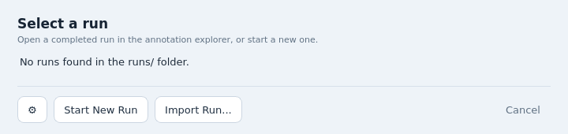

Click **Import Run...**. In the Import Run window, click **Choose File...** and pick
`bactolomew_example_abaumannii_153.zip`. BACTolomew reads the package and shows what is in it:
153 genomes, the assemblies, a metadata CSV, and the size once unpacked.

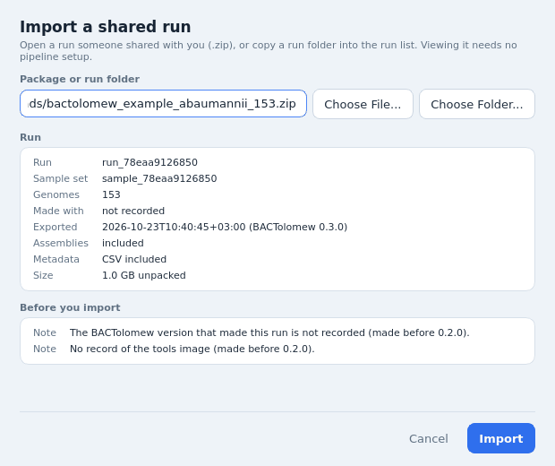

The two notes under **Before you import** are normal for this dataset: the run was made before
BACTolomew 0.2.0, which started recording its version and the tools image. They do not stop
anything from working.

Click **Import**. Unpacking takes a minute or two. When it's done, the run appears in the run
list with a **Shared** chip, which marks runs you imported.

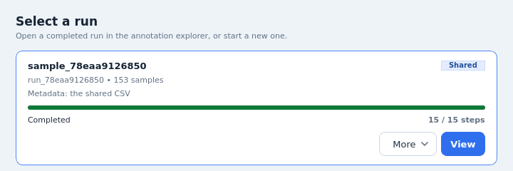

The card says "Metadata: the shared CSV": the package came with its metadata, and BACTolomew
will use it. The imported run lives in `runs/shared/` inside the BACTolomew folder.

## 3. Open the run

Click **View**. A loading window shows its progress for a few seconds, then the explore
window opens.

You won't be asked for a metadata CSV this time, because the package brings its own. With your
own runs BACTolomew asks for one: pick a CSV with a `Sample` column, or click **Use run data
only**. To swap the CSV later, use **More > Change Metadata...** on the run's card.

## 4. A tour of the explore window

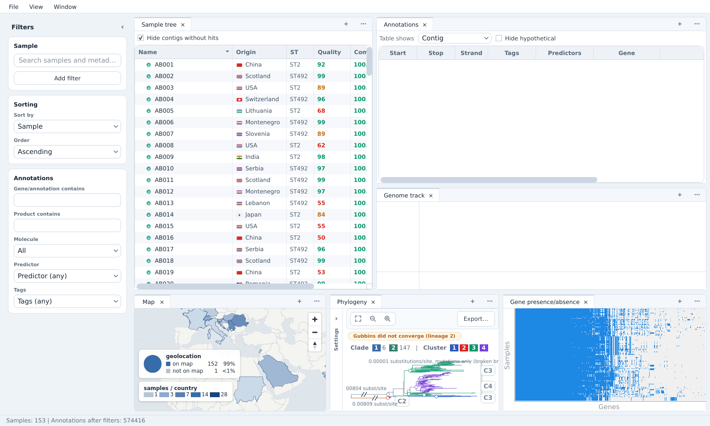

The window has three parts:

- **Filters** on the left. They decide which samples and annotations every panel shows.
- **Panels** on the right: the sample tree, the annotation table, the genome track, the map, the
  phylogeny, gene presence/absence and more. Each one is a tab you can drag, split or close.
- The **status bar** at the bottom, with the number of samples and annotations that pass the
  filters (153 samples to start with).

The **Annotations** table and the **Genome track** start empty: they show the contig you pick. The
sample tree lists only the samples at first, because **Hide contigs without hits** is checked.
Expand a sample in the sample tree (or uncheck that box) and click a contig to see its genes.
The gene search below fills them too.

Panels are linked. Hover a sample anywhere and it lights up in the other panels; filter in the
rail and they all follow. To get more room for one panel, double-click its tab (or use **View >
Maximize Active Group**), and double-click again to go back. **Window > New Panel...**
(Ctrl+Shift+P) opens any panel, and **Window > Layouts** switches between ready-made
arrangements (Classic, Genome focus, Pangenome, Geo + table). **View > Reset Layout** always
brings back the one you started with.

### The filter rail

Type in **Search samples and metadata** under **Sample** to keep only the matching samples: try
`Serbia`, or `492` for the ST492 genomes (the metadata stores the ST as a bare number). **Add
filter** puts a filter on any metadata column, such as ST or country. **Sorting** sets the order
of the sample tree. Under **Annotations** you search by gene name (**Gene/annotation contains**)
or by product, and narrow by molecule (plasmid only or chromosome only), predictor and tags such
as AMR.

Filters apply as you type. The rail can be folded with the small arrow next to **Filters**.

### Phylogeny and gene presence/absence

Choose **Window > Layouts > Pangenome** to see the tree and the gene presence/absence heatmap
side by side.

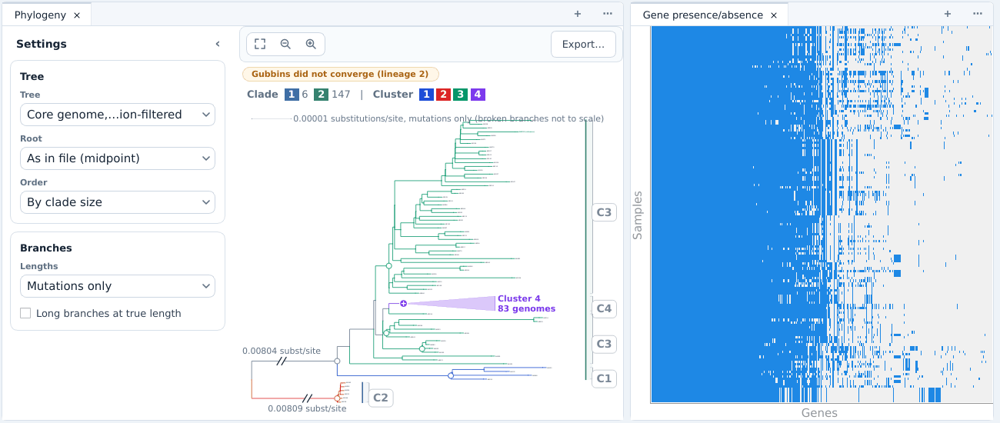

- The tree is built from the genes all genomes share (the core genome), after Gubbins removed
  the stretches that came in by recombination. Above it, the **Clade** and **Cluster** legend
  shows the population groups fastGEAR found in this run: clades are the large lineages, and
  clusters subdivide them. Branches are colored by cluster.
- The orange "Gubbins did not converge" chip is a note, not an error: Gubbins didn't fully
  converge for one lineage, and the tree is still usable.
- Each clade and cluster starts at a small round handle on its node. Click it to **collapse**
  the group into a triangle (here Cluster 4, 83 genomes); click again to expand it.
- **Settings** (the strip on the left side of the tree, or the arrow in its header) opens the
  tree options: which tree to draw, how to root it, the leaf order and the branch lengths.
- Hover a branch to see its support value. **Export...** saves the tree as an image.
- In the heatmap each row is a genome, in the same order as the tree's leaves, and each column a
  gene; blue means present. Drag or use the wheel to move along the genes.

### The map

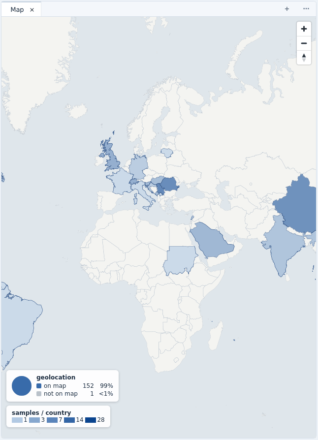

The map shades each country by how many samples come from it, and the boxes in the corner say
how many samples could be placed. It follows the filters: search for a gene and only the
countries of the samples that carry it stay shaded. Zoom with the buttons or the mouse wheel.
The **Geo + table** layout gives the map more room.

### Search for a gene

Go back to **Window > Layouts > Classic**. In the rail, type `blaOXA-23` (a carbapenemase gene)
into **Gene/annotation contains**.

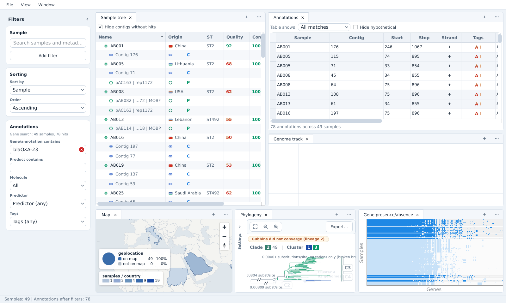

The rail reports "Gene search: 49 samples, 78 hits", and the status bar now reads
**Samples: 49**. Every panel shows only those 49 samples: the sample tree lists them with the
contigs that carry the gene, the map counts only them, and the tree and the heatmap gray out
the rest.

In the Annotations panel, set **Table shows** to **All matches** to list all 78 hits at once
(with **Contig**, it shows the contig you click in the sample tree). Scroll the table to the
right and click the page icon in the **Details** column of a row to open its gene card.

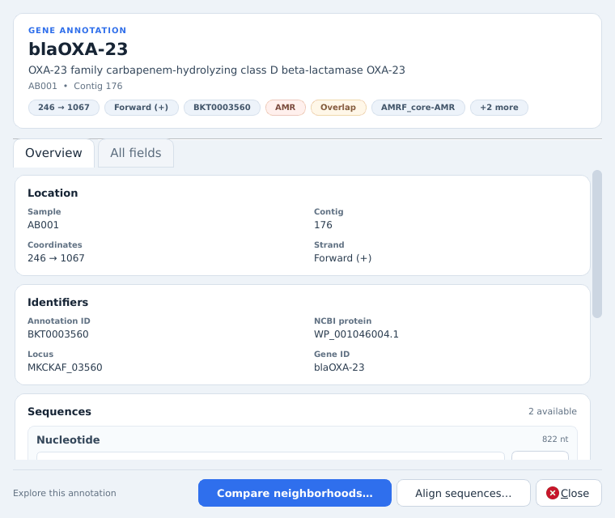

The gene card shows where the gene sits, its identifiers and sequences, and every annotation
field. The buttons at the bottom compare it across samples.

### Gene neighborhoods

Click **Compare neighborhoods...** on the gene card. BACTolomew finds the same gene in the
other samples and lines up the genes around it, in a new explore window with the same filters.

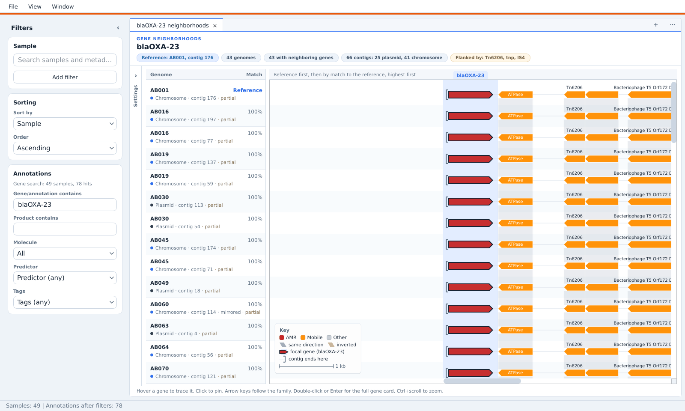

- The list on the left has one row per contig, with the reference (the gene you started from)
  first and the others by how well their neighborhood matches it.
- The chips at the top summarize the comparison: how many genomes and contigs, how many are on
  plasmids or chromosomes, and the mobile elements that flank the gene (here Tn6206).
- Colors follow the key: AMR genes red, mobile elements orange. Hover a gene to trace it across
  the rows, click it to pin it, and double-click for its gene card.
- **Settings** (the strip on the left of the drawing) holds the comparison's options.

When you're done, close it with **File > Close Window** (the colored bar at the top marks it as
the second window); the first one is still open behind it. Clear the gene search
(the small x in the field) to get all 153 samples back.

### cgMLST minimum spanning tree

Open **Window > New Panel...** and choose **cgMLST MST** (not the compact one). It opens as a
new tab next to the sample tree; click a tab to switch, or drag it to place it beside another
panel.

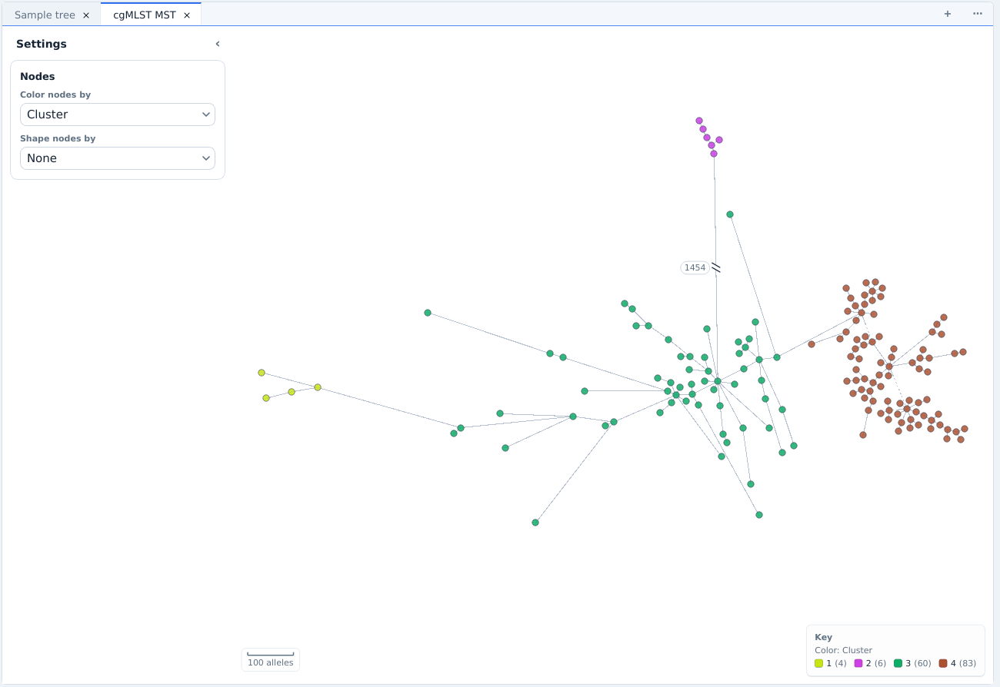

Each node is a genome, and an edge's length is how many cgMLST alleles differ between the two
genomes it joins (the scale bar shows 100). A very long edge is drawn shortened with a break mark and its true length,
like the 1454 alleles between the two clades here. **Color nodes by** and **Shape nodes by** in
its Settings take any metadata column: here the nodes are colored by cluster.

### Pangenome clustering

One more panel worth a look: **Pangenome clustering** (also under **Window > New Panel...**). It
places the genomes by how alike their gene content is (multidimensional scaling), and groups them
into k clusters.

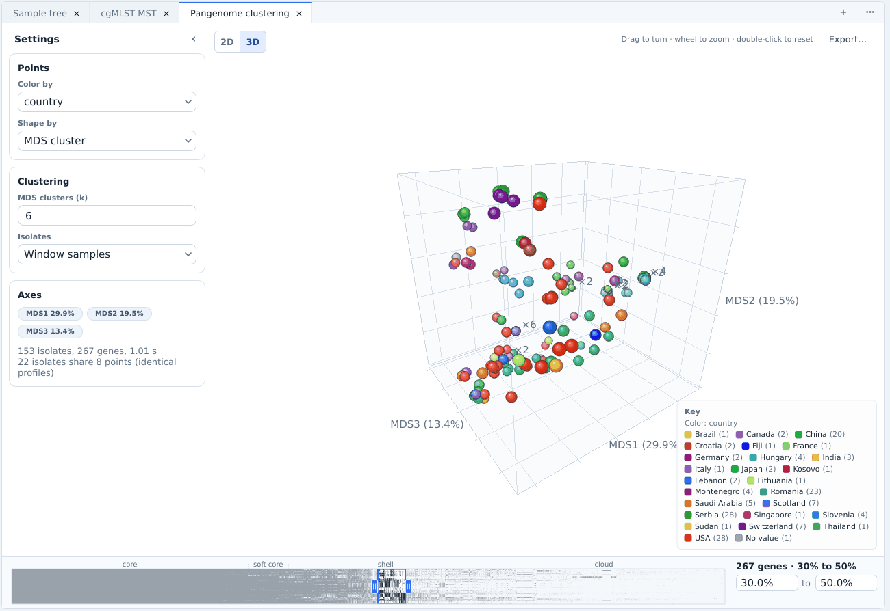

- **2D** and **3D** switch the view. In 3D, drag to turn, use the wheel to zoom, and double-click
  to reset.
- **Color by** and **Shape by** take the clusters or any metadata column (country here).
- The band at the bottom picks which genes count, by how many genomes carry them: by default genes
  carried by 30% to 50% of the genomes, a slice of the shell genes (the band marks core, soft
  core, shell and cloud). Drag its handles or type a range.
- **MDS clusters (k)** sets the number of clusters.

## 5. Where to go next

- **Run your own assemblies.** That needs the full install: see
  [Set up the full pipeline](../README.md#set-up-the-full-pipeline). A viewer becomes a full
  install with **Set Up Pipeline...** in Settings (the gear button in the run list); see
  [Turn a viewer into a full install](../README.md#turn-a-viewer-into-a-full-install).
- **Share your runs.** In the run list, **More > Export for Sharing...** packs a finished run
  into one `.zip`, like the one you just imported. See [Share a run](../README.md#share-a-run).
- **Learn more.** The README covers [the run list](../README.md#the-run-list), the
  [command line and HPC](../README.md#command-line-and-hpc), [gene categories](../README.md#gene-categories),
  [your own databases](../README.md#your-own-databases) and the [outputs](../README.md#outputs) a
  run writes. [docs/INSTALL.md](INSTALL.md) has help with installation problems.

To remove the example, open its **More** menu in the run list and choose **Remove...**.
